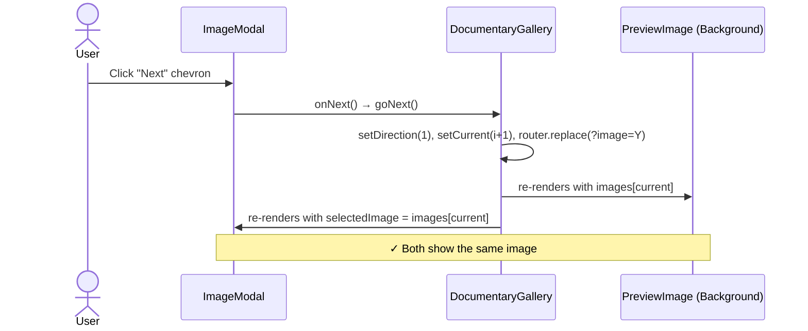

# Plan: Simplify Documentary Gallery — Stable Ordering + Modal-Gallery Sync

## Problem Summary

Three interconnected issues make the modal and gallery images inconsistent:

1. **Randomized ordering** (`getImageList()` Fisher-Yates shuffle) means the same image is at a different index on every server restart. This makes index-based navigation unreliable across sessions.
2. **Deep link opens modal without updating `current`** — when arriving via `?image=X.jpg`, the modal shows X but the gallery background still shows `images[0]`.
3. **No modal navigation** — once open, the modal is a dead-end; no way to browse prev/next without closing.

## Root Cause Map

```
getImageList()
  └── Fisher-Yates shuffle ──► non-deterministic ordering
                                  ├── Deep link: can't set `current` by index at page load
                                  ├── Modal nav: can't rely on `current +/- 1` staying correct
                                  └── Shared mutable cache: first visitor's order imposed on all
                    + openModal() never sets `current`
                    + deep link effect never sets `current`
                    = MODAL AND GALLERY SHOW DIFFERENT IMAGES
```

## Plan

### Step 1: Stable Image Order (Remove Randomization)

**File:** `src/app/(pages)/documentary-portfolio/imageList.ts`

**Changes:**
- Delete lines 63-67 (the Fisher-Yates shuffle block)
- Add `images.sort((a, b) => a.filename.localeCompare(b.filename))` for deterministic ordering

**Why:** A stable, predictable order eliminates the root cause of the sync problem. Without this, every index-based operation needs filename lookups and workarounds. The shuffle provided zero UX benefit — the slideshow auto-advances anyway, and real users don't benefit from a different random order on each server restart.

**Trade-off discussed:** If randomness on every visit was intentional, we could shuffle client-side in a `useEffect` on first mount instead of server-side. But that would cause a flash of content on re-render. The simpler and more predictable approach is stable ordering. If the user wants randomness, we can add a per-session client-side shuffle as a separate feature later.

**Effect on deep links:** A shared URL `?image=X.jpg` will now always show X at the same index, making navigation predictable and enabling index-based operations in prev/next.

### Step 2: Fix Deep Link Handler — Sync `current`

**File:** `src/app/(pages)/documentary-portfolio/components/DocumentaryGallery/DocumentaryGallery.tsx`

**Changes in the deep link effect (lines 67-81):**
- After finding the matched image by filename, compute its index
- Call `setCurrent(idx)` so the gallery background snaps to match

```typescript
// Before (buggy):
setSelectedImage(match);
setModalOpen(true);
// current stays at 0

// After (fixed):
const idx = images.findIndex(img => img.filename === match.filename);
setCurrent(idx);
setSelectedImage(match);
setModalOpen(true);
```

**Effect:** When arriving via deep link, both the modal and the gallery background show the same image.

### Step 3: Fix `openModal` — Snap `current` to the Image's Index

**File:** `src/app/(pages)/documentary-portfolio/components/DocumentaryGallery/DocumentaryGallery.tsx`

**Changes in `openModal` (lines 40-51):**
- After receiving an image, find its index in the `images` array and set `current`
- This is already implicitly true in the click path (InfoCard passes `images[current]`), but making it explicit is defensive

```typescript
const openModal = useCallback((image: GalleryImage, updateUrl: boolean = true) => {
  previousPlayStateRef.current = isSlideShowPlaying;
  const idx = images.findIndex(img => img.filename === image.filename);
  if (idx !== -1) setCurrent(idx);
  setSelectedImage(image);
  setModalOpen(true);
  // ... URL update stays the same
}, [isSlideShowPlaying, images, router]);
```

**Effect:** Regardless of how the modal is opened (click, deep link, future touch point), `current` always tracks the correct image, so closing the modal reveals the same image in the gallery background.

### Step 4: Add Chevron Navigation to the Modal

**File:** `src/app/(pages)/documentary-portfolio/components/ImageModal/ImageModal.tsx`

**Changes:**
- Accept new props: `onPrev?: () => void`, `onNext?: () => void`
- Overlay left/right chevron buttons on the image container (positioned absolutely, semi-transparent on hover)
- Chevron buttons call the respective callbacks
- Hide/show logic: no chevrons at boundaries (or wrap around to match gallery behavior)

**File:** `src/app/(pages)/documentary-portfolio/components/DocumentaryGallery/DocumentaryGallery.tsx`

**Changes:**
- Pass `goPrev` and `goNext` as `onPrev`/`onNext` to `ImageModal`
- These already increment/decrement `current` and update the URL via the existing `goPrev`/`goNext`

```typescript
<ImageModal
  image={selectedImage}
  onPrev={goPrev}
  onNext={goNext}
/>
```

**Effect on gallery sync:** Since `goPrev`/`goNext` update `current`, and the `PreviewImage` keyed on `current` re-renders with the new image, both modal content and gallery background update simultaneously.

### Step 5: Modal Keyboard Navigation

**File:** `src/app/(pages)/documentary-portfolio/components/DocumentaryGallery/DocumentaryGallery.tsx`

**Changes:**
- Instead of returning early from the keyboard handler when `modalOpen` is true, check which key pressed:
  - Left/Right arrows in modal → call `goPrev()`/`goNext()` (same functions, they update both modal and gallery)
  - This can be handled inside the existing `useEffect` by adding the modal-aware key handling, OR by adding a separate effect that only fires when `modalOpen` is true

Note: Escape key is already handled by Radix Dialog's built-in behavior (closes the dialog).

```typescript
useEffect(() => {
  const handler = (e: KeyboardEvent) => {
    if (e.key === "ArrowLeft") goPrev();
    if (e.key === "ArrowRight") goNext();
    // Escape is handled by Radix Dialog
  };
  window.addEventListener("keydown", handler);
  return () => window.removeEventListener("keydown", handler);
}, [goPrev, goNext]);  // Remove modalOpen guard — keyboard nav works everywhere
```

**Safety note:** Remove the `if (modalOpen) return` guard so that left/right arrows work both in the gallery (when no modal) and in the modal. This is safe because `goPrev`/`goNext` don't interact with modal-specific state — they just change `current` and `direction`, which are used by both views.

## Files Touched

| File | Changes |
|------|---------|
| `src/app/(pages)/documentary-portfolio/imageList.ts` | Remove Fisher-Yates shuffle (lines 63-67); add deterministic sort |
| `src/app/(pages)/documentary-portfolio/components/DocumentaryGallery/DocumentaryGallery.tsx` | (a) Fix deep link effect to set `current`; (b) Fix `openModal` to set `current`; (c) Pass `goPrev`/`goNext` to `ImageModal`; (d) Remove `modalOpen` guard from keyboard handler |
| `src/app/(pages)/documentary-portfolio/components/ImageModal/ImageModal.tsx` | Add `onPrev`/`onNext` props; render prev/next chevron buttons overlaid on image |

## Data Flow (After)



## Acceptance Criteria

- [ ] Image order is deterministic and stable across server restarts and deployments
- [ ] Deep link `?image=X.jpg` shows X in both modal AND gallery background
- [ ] Clicking "Get a Print" in InfoCard shows the current image in both modal and gallery
- [ ] When modal closes, gallery background shows the same image the modal was just displaying
- [ ] Chevron arrows appear inside the modal overlaid on the image
- [ ] Clicking chevron arrows updates both the modal content and the gallery background simultaneously
- [ ] Left/right arrow keys work for navigation whether modal is open or closed
- [ ] Escape key still closes the modal (via Radix Dialog built-in)
- [ ] Slideshow pause/resume behavior is preserved
- [ ] `npm run lint` passes
- [ ] `npm run typecheck` passes
- [ ] `npm run build` succeeds
